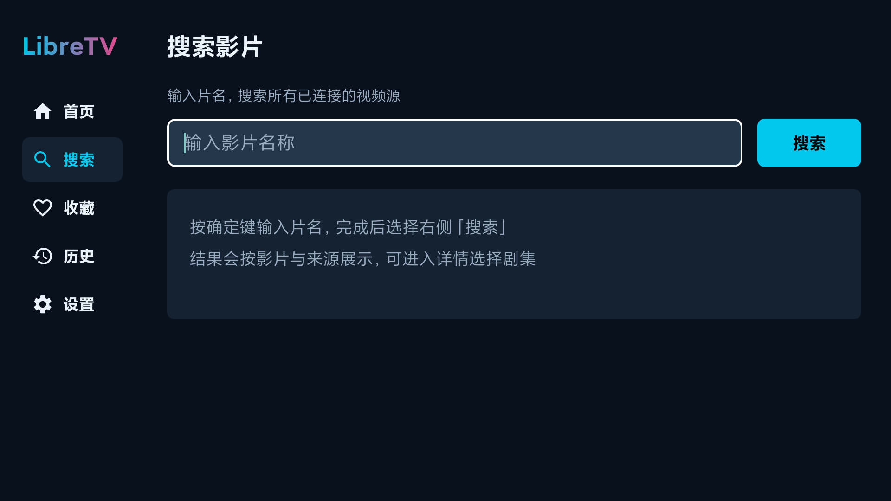
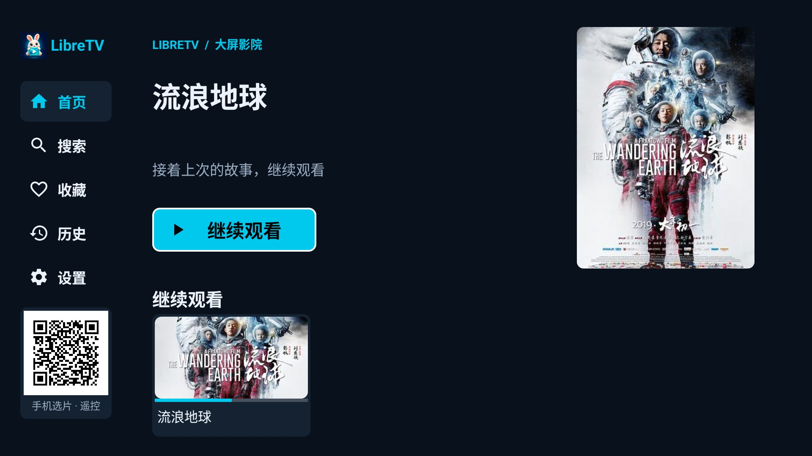
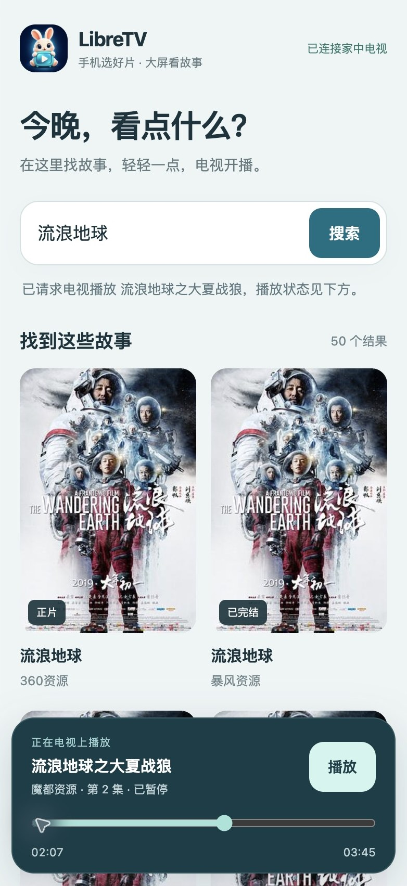

# LibreTV Android TV


面向 Android TV 与电视遥控器的原生 LibreTV 客户端。采用 Kotlin、Android Views 与 Media3，连接用户自行部署的 LibreTV 服务，提供影片搜索、详情选集、播放、收藏和观看记录。

> **仅供个人学习、研究与测试使用。** 本项目不是商业影视服务，不提供或托管视频内容；请只连接你有权访问的服务并播放已获合法授权的内容。使用前请阅读下方用途与免责声明。



## 功能

- 电视横屏布局，大字号与醒目的遥控焦点；输入框获焦不放大、不裁切。
- 五向遥控操作、网格跨行导航、返回列表恢复原焦点。
- 搜索多个服务端视频源、查看详情与选择剧集。
- Media3 播放、暂停、进度调整、下一集、换源与断点续播。
- 按服务地址隔离的本机收藏与观看记录。
- 服务连接检测、封面等比裁切与明确的加载状态。
- 兔子电视图标；常驻二维码，手机搜索选片，电视播放，手机同步暂停、继续与拖动进度。

## 项目关系与运行条件

这是基于 [LibreSpark/LibreTV](https://github.com/LibreSpark/LibreTV) 服务接口开发的独立 Android TV 客户端，不是上游官方 Android 应用，也不代表上游维护者。

- Android 6.0（API 23）及以上；当前实测为 Android 10 小米电视、1920×1080。
- 需要另行部署与本客户端接口兼容的 LibreTV 服务，本仓库不包含服务端。
- 电视必须能够访问服务地址。初始示例地址为 `http://192.168.31.1:8899`，请进入「设置」替换为自己的地址并检测保存。
- 服务要求鉴权但未提供本客户端支持的认证方式时会显示错误，不绕过服务端认证。
- 封面、搜索与播放质量取决于服务端和来源；未保证所有厂商电视、格式或第三方服务可用。

## 手机选片与遥控（1.3.0）

1. 在电视侧栏「设置」下方直接扫描二维码；也可用遥控器移到二维码，按确定放大。
2. 手机与电视连接同一局域网，用浏览器打开二维码页面。
3. 输入片名，搜索结果直接显示在手机上。点击单集影片即可请求电视播放；多集内容先在手机选集。
4. 电视开始播放后，手机底部显示悬浮播放条：可暂停、继续、拖动进度，电视遥控器操作也会同步到手机。

网页与遥控服务由电视应用自身提供，无需电脑或云端控制服务。应用前台期间可连续搜索和播放，跨搜索/播放页面保持连接；退出到其他应用后关闭连接，重新打开应用会生成新的二维码。手机页每秒读取一次真实状态，隐藏页面时停止轮询；网络断开会禁用控制并提示，旧影片的进度操作不会作用于新影片。




手机与电视必须互通（电视可以用同一路由器的网线连接）；访客 Wi-Fi、AP 隔离或 VPN 可能阻止访问。使用局域网 HTTP 与随机会话令牌，请在可信家庭网络使用，不向公网转发端口。手机通过电视配置的 LibreTV 服务取得真实搜索结果与封面；影片播放能力取决于服务端来源。直播或不可跳转的媒体会禁用进度拖动。

## 构建

环境：JDK 17、Android SDK 36、Gradle Wrapper 8.13。依赖版本由项目构建文件固定。

1. 安装 Android SDK，并在本地 `local.properties` 中填写 `sdk.dir=/你的/Android/SDK/路径`，或配置 `ANDROID_HOME`。
2. 执行：

```sh
./gradlew :app:testDebugUnitTest :app:lintDebug :app:assembleDebug
```

调试 APK：`app/build/outputs/apk/debug/app-debug.apk`。

```sh
adb install -r app/build/outputs/apk/debug/app-debug.apk
```

正式构建：

```sh
./gradlew :app:assembleRelease
```

本仓库不包含发行签名私钥或密码。正式签名使用本地 `.signing/release.jks` 与 `.signing/signing.properties`：

```properties
storePassword=YOUR_LOCAL_KEYSTORE_PASSWORD
keyAlias=YOUR_KEY_ALIAS
```

没有该配置时，debug 使用 Android 默认调试签名，release 为未签名产物。自行构建的不同签名 APK 不能直接覆盖其他签名版本。请妥善保管自己的签名材料，不要提交到仓库。

## 遥控器操作

| 场景 | 操作 |
| --- | --- |
| 侧栏 | 上下选择栏目，确定进入，右键回内容 |
| 搜索输入 | 确定打开系统输入法；文本开头左键回侧栏，文本末尾右键进入搜索按钮 |
| 影片网格 | 方向键移动，确定进入；末行不足列时选择最近有效项目 |
| 播放控制隐藏 | 确定显示控制；左右进入进度调整 |
| 进度条获焦 | 左右跳转10秒；媒体快进/快退键跳转30秒 |
| 播放返回 | 先关闭控制层，再返回详情；退出后台暂停并保存进度 |
| 选集弹窗 | 方向键选择、确定播放、返回关闭 |

## 测试

```sh
./gradlew :app:testDebugUnitTest :app:lintDebug
./gradlew :app:assembleDebug :app:assembleDebugAndroidTest
adb install -r app/build/outputs/apk/debug/app-debug.apk
adb install -r app/build/outputs/apk/androidTest/debug/app-debug-androidTest.apk
adb shell am instrument -w app.libretv.tv.test/app.libretv.tv.TvInstrumentation
```

目标应用与测试 APK 必须使用相同签名。设备测试需要可访问的服务；`-e playback true -e query 你的片名` 可启用真实搜索与播放测试，会产生真实观看记录。持久化测试使用独立 QA 偏好文件，测试后清理；截图保存到应用外部文件目录的 `qa-*.png`。

版本1.1.0已通过15项JVM测试，以及上述小米电视上的输入框边界、跨屏网格导航、封面裁切、焦点恢复、真实播放、下一集、快进和续播验证。此结果不代表所有电视与来源均已验证。

版本 1.3.0 的验证范围见 [验证记录](docs/remote-validation.md)。按用户要求，本次仅使用本地 Android 模拟器与浏览器，未操作、安装或验证已关机的实体电视。历史 1.1.0 真机结论不能替代新遥控功能的真机验收。

遥控集成测试：`adb -s 目标设备 shell am instrument -w -e remote true -e query 流浪地球 app.libretv.tv.test/app.libretv.tv.TvInstrumentation`。测试使用真实服务搜索和播放，并验证暂停、进度、反向状态、切换影片、后台关闭连接；仅应在测试设备运行。手机同步逻辑检查：`node tools/test-phone-ui.cjs`。

## 代码结构

- `MainActivity.kt`：生命周期、侧栏导航与请求调度。
- `HomeScreen.kt`、`SearchScreen.kt`、`DetailScreen.kt`、`LibrarySettingsScreen.kt`：页面布局与交互。
- `PlaybackActivity.kt`：播放生命周期与遥控控制。
- `LibreTvApi.kt`：服务接口；`WatchStore.kt`：本机记录；`FocusMemory.kt`：焦点恢复。
- `Images.kt`：封面加载、裁切、缓存与体积限制。
- `RemoteControl.kt`、`RemoteQr.kt`、`LanInputServer.kt`、`assets/phone-input.html`：前台会话、二维码、LAN 协议与手机遥控页面。
- `app/src/test`、`app/src/androidTest`：单元测试与电视设备测试。

## 个人测试用途与免责声明

1. 本项目由维护者作为个人学习、技术研究和设备适配测试项目提供，不构成影视内容服务、内容授权或商业运营承诺。
2. 本项目不提供、存储或分发影视文件，也不出售会员或内容访问权限。服务、来源和播放内容由使用者自行配置或通过其连接的服务取得；相关内容权利属于各自权利人。
3. 使用者应遵守所在地法律法规及服务条款，仅处理自己拥有权利或获得合法授权的内容，不得用于侵权传播、非法牟利或其他违法活动。
4. 软件按“现状”提供。在适用法律允许的范围内，不作可用性、准确性、持续维护、特定用途适用性等保证；对使用或无法使用本软件造成的损失，不承担超出适用法律及许可证规定的责任。
5. 发现与本项目相关的权利或安全问题，可通过仓库 Issues 联系维护者，并提供必要的可核查信息。请勿公开提交密钥、密码或个人敏感数据。
6. 上述“个人学习、研究与测试”描述维护目的和使用倡议，不修改、缩减或替代开源许可证授予的权利；许可及责任条款以 [LICENSE](LICENSE) 与适用法律为准。

## 许可与致谢

项目沿用 GNU Affero General Public License v3.0，完整文本见 [LICENSE](LICENSE)。LibreTV 名称和上游项目归各自权利人所有；本项目与上游不存在官方背书关系。

Material 图标、AndroidX/Media3、Kotlin 与 Gradle 等第三方组件保留各自许可，详见 [THIRD_PARTY_NOTICES.md](THIRD_PARTY_NOTICES.md)。
